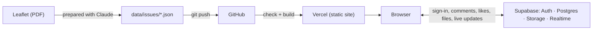

# תורה שבענן · Torah in the Cloud

**תורה שבכתב, תורה שבעל פה, ועכשיו תורה שבענן.** כשהתורה שבכתב נכתבה, היא התקבעה. תורה שבענן מבקשת לחזור לשיח תוסס סביב הטקסט, בכלים שמתאימים לחברה שעברה דמוקרטיזציה: הידע מפוזר אצל הרבה אנשים, והפלטפורמה מנסה לחבר אותו למקום אחד, מסודר ועם מקורות.

**Live:** [torah-beanan.vercel.app](https://torah-beanan.vercel.app) · Built by **Aviv Bryger · אביב בריגר**, with code written by [Claude Code](https://claude.com/claude-code)

<!-- screenshots: docs/screenshot-desktop.png, docs/screenshot-phone.png -->

## The idea

We had the Written Torah, then the Oral Torah. The written text, once fixed, stopped moving; the oral tradition kept the conversation alive but depended on a small circle of scholars. Today knowledge is spread across many people, each with their own field. Torah in the Cloud is a platform for the next layer: a shared, living commentary where anyone can interpret, respond, disagree and share ideas, in an orderly way and with sources.

The test case is **"Parashat HaShavua for Engineers"**, a weekly Shabbat leaflet I write that studies a question in the Torah portion through a scientific idea (many-body orbits, phase separation, the Kapitza pendulum). Each leaflet becomes a digital Talmud page: the essay in the center, and around it three layers.

| Layer | What it is | Who writes it |
| --- | --- | --- |
| **באר הפוטנציאל** (The Well of Potential) | The science behind the essay, with the formula and a line tying it back to the text | The author |
| **מקורות** (Sources) | Every source cited, in full, linked to [Sefaria](https://www.sefaria.org) | The author |
| **מפרשי הקהילה** (Community commentators) | Comments on a sentence or a paragraph, with a link, image or PDF | Anyone who signs in |

## Product decisions

- **Two ways to read.** *By paragraph*: the leaflet itself; tap a paragraph to open everything written on it. *By commentator*: everything one person wrote, across all leaflets, with their 👍 score. The second mode turns participants into authors with a body of work.
- **Pen names, not real names.** In the tradition, commentators are known by their works (the "Ba'al HaTanya"). Each participant picks a unique pen name; renaming applies retroactively, because comments store the user id and the name lives in one place.
- **👍 on everything, including the author's notes.** The science notes compete for attention like everyone else's comments, and the score ranks commentators.
- **One-tap Google sign-in.** I weighed it against a 6-digit email code: Google is one tap on a phone and has no email rate limits on launch day; an email code can be added later as a fallback for anyone without a Google account.
- **Moderation that explains itself.** An admin can hide or delete a comment, and can lock a paragraph's discussion. A lock requires a reason that everyone sees in place of the comment form; likes keep working.
- **A weekly routine with a safety net.** Leaflets are prepared outside the site (from the PDF, with Claude) as a JSON file. Adding the file to the repo publishes it. Before every deploy, a check stops the build if an id is duplicated, a note points at a missing sentence, or a comment in the database would lose its sentence.
- **Scope cuts.** Migrating comments from the prototype was planned, then dropped: it held no real content. Branding the Google sign-in screen needs a custom domain and Google brand verification; deferred.
- **Cost: zero.** Free tiers of Vercel and Supabase cover a WhatsApp-group-sized community.

## How it was built with Claude Code

I led the project: the vision, the plan, every product decision, and testing each stage. Claude Code wrote the code and the SQL.

1. **Start from a working prototype.** The first version was a single HTML page. Claude Code split it into a Vite project and moved the leaflets into data files.
2. **A plan in stages.** [PLAN.md](PLAN.md) breaks version 1 into six stages, each ending in something that works and can be tried: a read-only site, sign-in and pen names, comments and likes, attachments, moderation, launch.
3. **One stage at a time.** For each stage Claude Code wrote a database migration ([supabase/migrations/](supabase/migrations/)) and the app changes; I ran the SQL in Supabase and tested in two browser windows (two users) before anything was committed.
4. **Questions where the decision is mine.** When a request had more than one reasonable shape, such as whether a lock applies to a paragraph or a whole leaflet, Claude Code asked instead of guessing.
5. **Bugs found by testing, fixed at the root.** Two examples: sign-in on localhost returned to the live site (a redirect URL that did not match exactly), and deleted attachments stayed in storage (Supabase Storage needs *select* permission to delete). Both were caught in a stage's test pass, not by users.

The commit history follows the stages, so the process is visible in `git log`.

## Architecture



There is no server of our own. Leaflets are static files bundled at build time; everything participants write goes from the browser straight to Supabase.

| Part | Choice |
| --- | --- |
| Front end | Plain HTML, CSS and JavaScript with [Vite](https://vitejs.dev) |
| Sign-in | Supabase Auth with Google (PKCE flow) |
| Data | Supabase Postgres with Row Level Security |
| Attachments | Supabase Storage, one folder per user |
| Live updates | Supabase Realtime |
| Hosting | Vercel, deploying every push to `main` |

### Security model

The browser holds only Supabase's publishable key, so every rule is enforced in the database with Row Level Security, not in the interface. Someone calling the API directly gets the same limits:

- Everyone can read pen names, visible comments, likes and locks.
- A signed-in user can add comments only as themselves, only after choosing a pen name, and not on a locked paragraph.
- Users delete only their own comments, likes and files; admins can delete or hide any comment.
- An attachment must sit in its author's folder, be an image or PDF, and be under 20MB; Storage enforces the type and size.

### Engineering notes

- **PKCE keeps deep links working.** Links to a leaflet use the URL hash (`#noach`). The PKCE flow returns the sign-in code in the query string, so the hash survives the round trip to Google.
- **Hiding a comment reaches everyone at once.** Realtime does not tell other users about a row they are no longer allowed to read. When an admin hides a comment, the admin's browser broadcasts its id, and each browser asks the database whether it may still see it. The broadcast is only a hint, so a fake one cannot hide anything.
- **Scores are computed, not stored.** A commentator's score is the sum of likes on their comments; deleting a comment deletes its likes with a trigger, so scores stay correct.
- **Stable ids.** Comments point at sentence ids in the leaflet files. Ids are prefixed per leaflet (`lech:5i`), never change after publishing, and [scripts/check-issues.js](scripts/check-issues.js) enforces this on every build.

## Run locally

```sh
npm install
npm run dev      # http://localhost:5173
npm run build    # checks the leaflets, then builds into dist/
```

## Add a leaflet

Put a JSON file in `data/issues/` (the format is in [PLAN.md](PLAN.md)) and push. The check runs, Vercel rebuilds, and the site opens on the newest leaflet by date.
